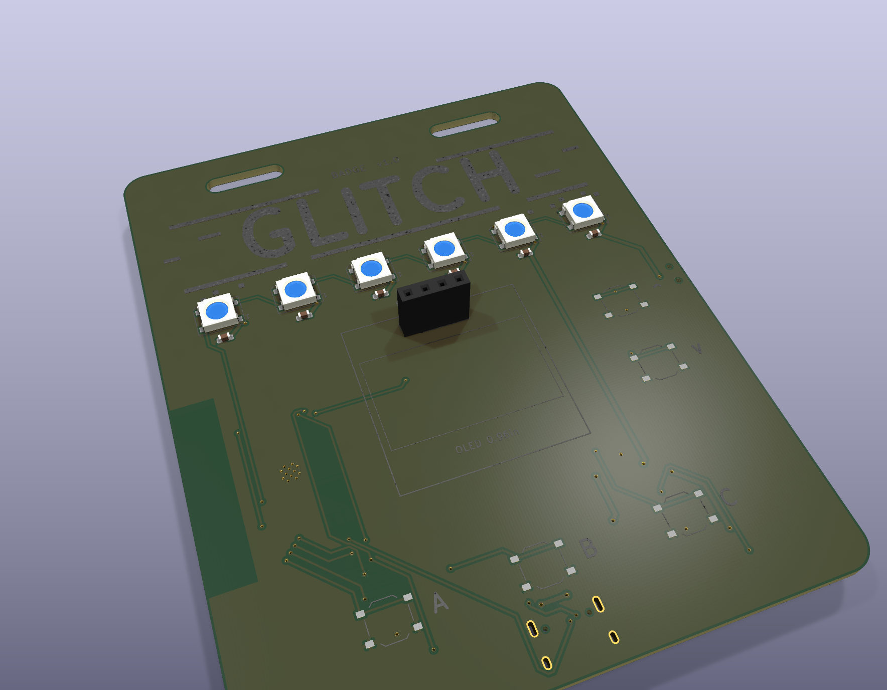
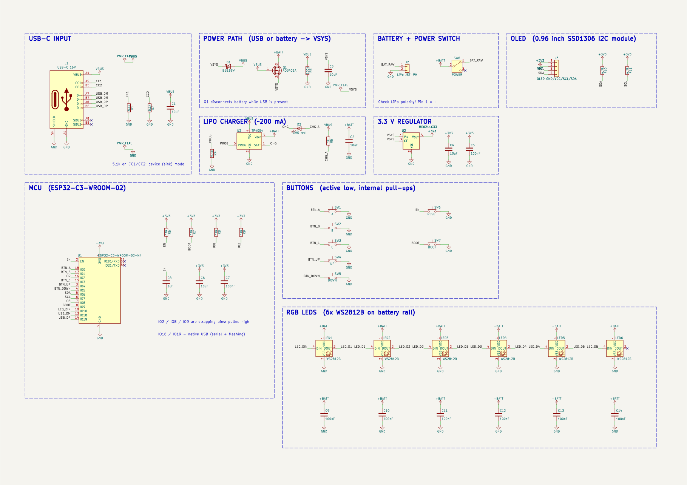
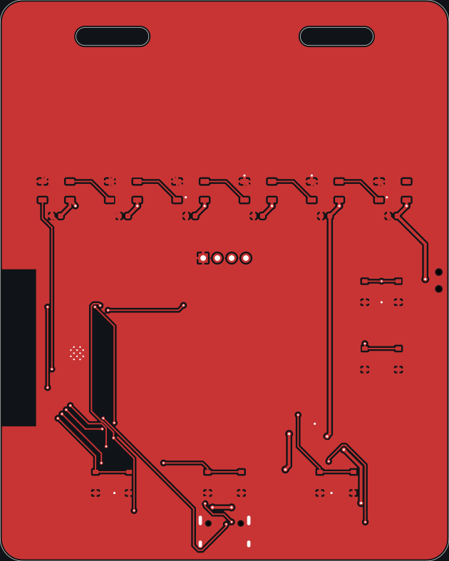
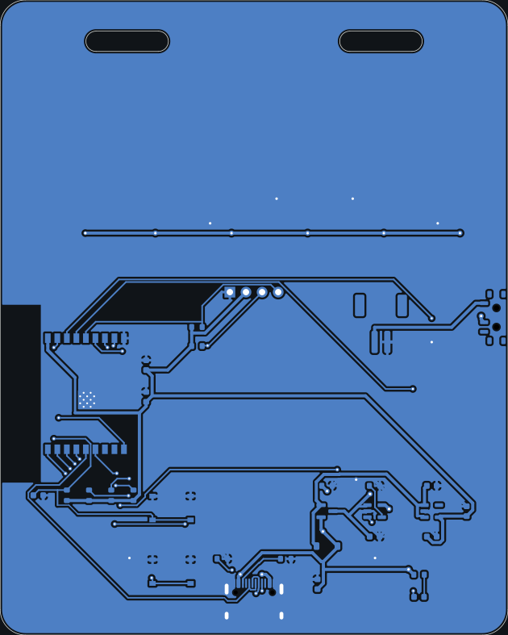
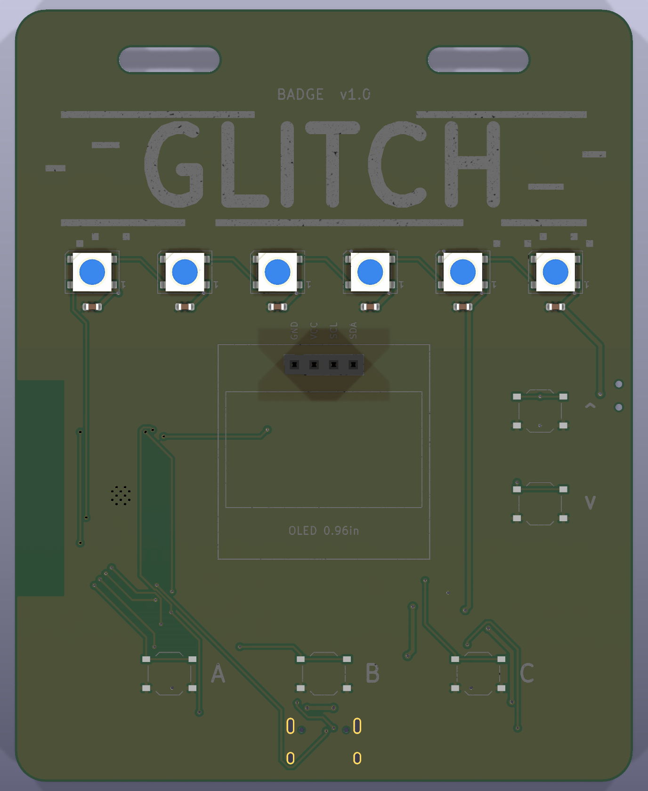
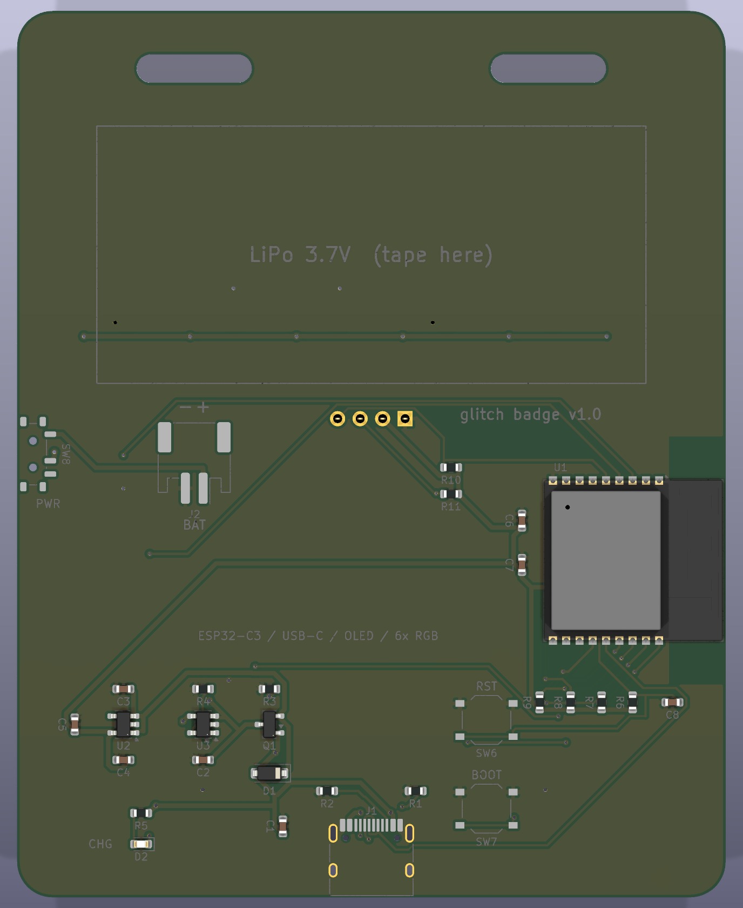

<h1 align="center">
  GLITCH
   
</h1>
<h4 align="center">
a wearable conference badge PCB
</h4>

  <a href="#key-features">Key Features</a> •
  <a href="#pcb">PCB</a> •
  <a href="#credits">Credits</a> 

&nbsp;

# GLITCH

GLITCH is a lanyard badge in the style of the tech-conference PCB badges, built around an ESP32-C3 with an OLED display, 5 buttons and a row of RGB LEDs, running off a LiPo that charges over USB-C.

the front is the part you look at: the silkscreen art, the LEDs, the display and the buttons. all the actual electronics live on the back, along with a spot to tape the battery.

to build your own, grab the KiCad files, check out the schematic and BOM, and send the Gerber files to your preferred PCB manufacturer. the ESP32-C3 is flashed straight over USB-C, hold BOOT and tap RST to get into the bootloader.

## Key Features

* **ESP32-C3-WROOM-02** module with WiFi and Bluetooth LE
* **USB-C** for charging, flashing and serial (native USB, no bridge chip)
* **0.96" SSD1306 OLED** on a 4 pin I2C socket
* **6x WS2812B** addressable RGB LEDs
* **5 front buttons** (A, B, C, up, down) plus reset and boot on the back
* **LiPo charging** using TP4054 (~200mA) with a charge LED
* **Power path** using AO3401A and a Schottky, so USB takes over when plugged in
* **3.3V regulation** using ME6211
* **Power switch** and JST-PH battery connector
* **2-layer PCB**, 80 x 100 mm, with lanyard slots
* every part has an **LCSC** part number

## PCB

generated for KiCad 10 as a 2-layer board. the layout has the LEDs, display socket and buttons on the front, and the ESP32 module, USB-C, charger, regulator and battery connector on the back.

the ESP32 antenna sits at the left edge of the board with a copper keepout around it. the USB-C connector is at the bottom edge and the power switch pokes out of the side. power nets are routed at 0.5mm, everything else at 0.25mm, with ground pours on both layers.

## Files

the repository includes the KiCad project files, schematic, BOM, Gerber exports,

* `pcb/` KiCad project
* `docs/` schematic PDF
* `production/` Gerbers and CPL
* `BOM.csv` bill of materials with LCSC part numbers
* `journal.md` build log

everything is open source, feel free to take a look, modify it or build your own!

### Schematic

---

### PCB Layers

#### F.CU

#### B.CU

---

### Board Views

#### Front

#### Back

## Before you build

* the board has not been manufactured or tested yet, it passes ERC and DRC and thats it
* check your LiPo polarity against the + and - on the silkscreen, JST-PH batteries are not all wired the same
* the OLED socket is GND / VCC / SCL / SDA, some modules swap the first two
* keep LED brightness low when running from USB without a battery

## Credits

This project uses:
- [KiCad](https://www.kicad.org/)

### ZINE

## License

GPL
