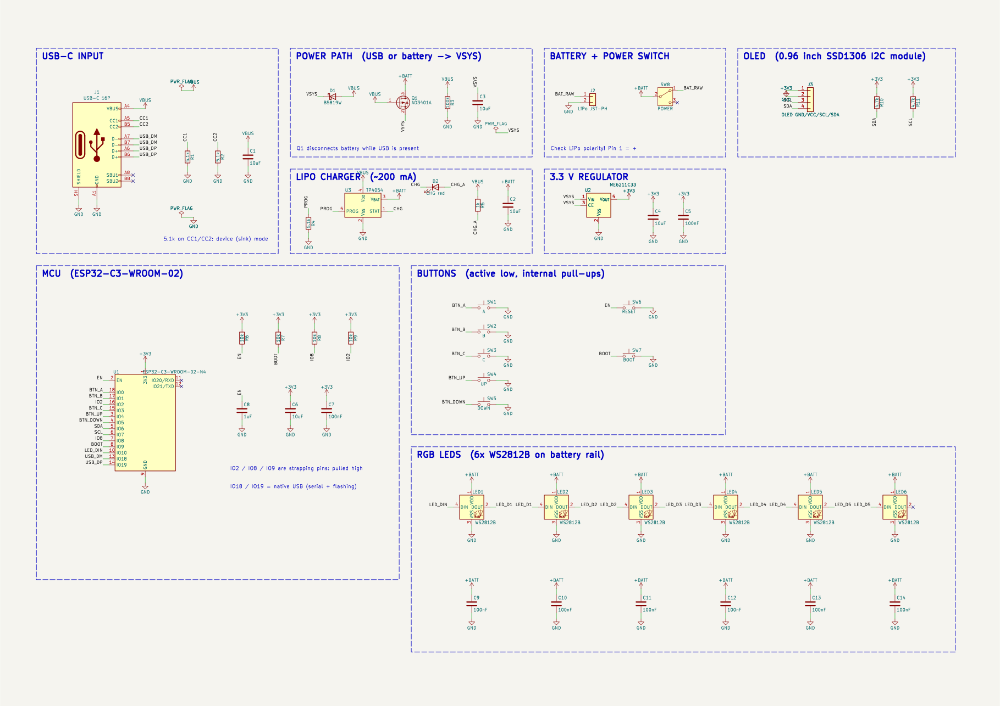
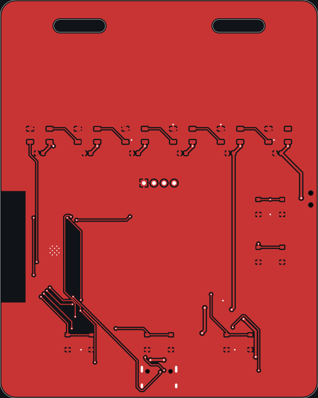
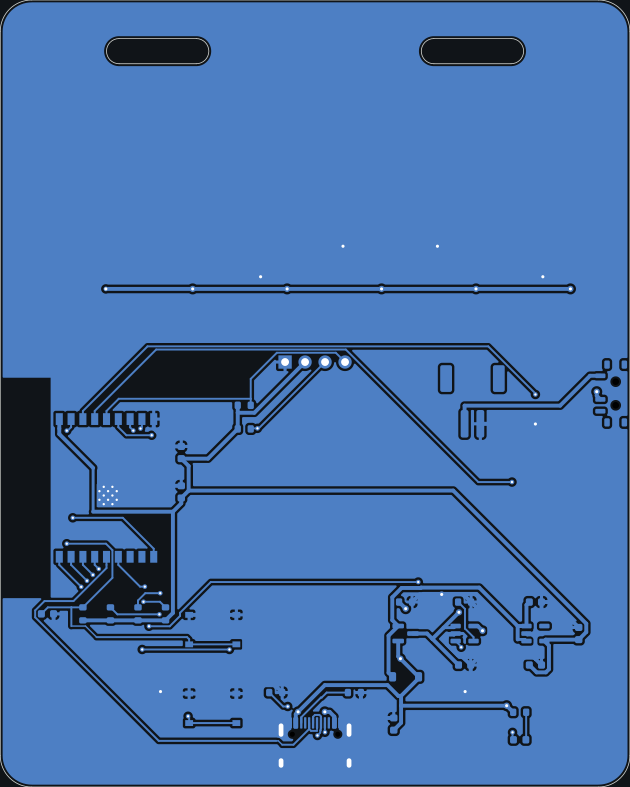
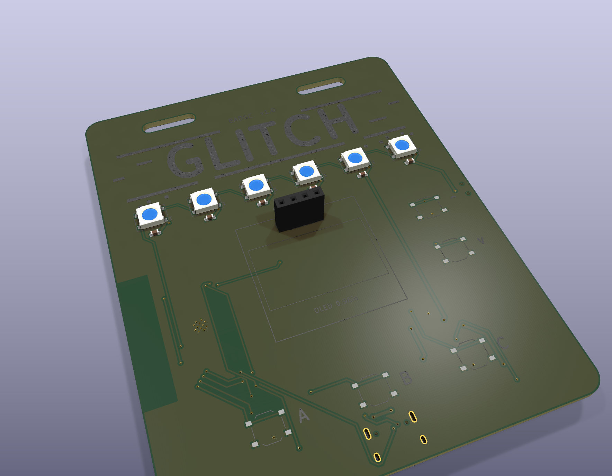

### TOTAL TIME: 35 HOURS

## Day 1 | GLITCH schematic | November 9th | 8 hours

okay so i recently attended a techcon and came across a really cool github page for a PCB badge. thought it would be pretty cool to make something similar myself, so here's GLITCH!

its basically a wearable badge with an ESP32-C3, a small OLED display, 5 buttons and some RGB LEDs. wanted to make something that actually looks like a techcon badge but is also a proper PCB with all the electronics on it.

started with the schematic in kicad. first got the ESP32-C3-WROOM-02 and its connections together. im using USB-C for flashing and serial communication, so no separate USB to UART chip needed.

also added the SSD1306 OLED display over I2C, the 5 buttons and the 6 WS2812B addressable LEDs. then worked on the power section with a TP4054 for LiPo charging, an AO3401A and schottky diode for the power path, and an ME6211 for the 3.3V rail.

heres the schematic!

took me a while to get all the different sections together and make sure everything was connected properly. still had to double check a few things before moving onto the actual PCB.

## Day 2 | starting the PCB layout | November 10th | 6 hours

finally moved onto the PCB!

started arranging all the components and figuring out how everything would fit. went with an 80 x 100mm board with 2 layers.

wanted to keep the front relatively clean since thats the part people will actually see. placed the OLED socket, buttons and LEDs on the front, while keeping most of the actual electronics on the back.

also worked on the board outline and added the lanyard slots. had to think about the ESP32 antenna placement too, so i kept it at the left edge of the board with some space around it.

heres how the front is looking!

placement took some time because there are quite a few components to fit in here. finally got a layout that i was happy with, so moved onto routing.

## Day 3 | PCB routing | November 11th | 7 hours

spent some more time on the PCB today, started routing!

worked on the front copper layer first and started connecting everything around the display, buttons and LEDs. tried to keep the traces organised and avoid making things unnecessarily complicated.

there's quite a lot going on around the front section, so routing took a bit longer than i expected. had to keep checking where the connections were going and how they would fit around the other components.

heres the front copper layer!

still had the entire back layer to work on, along with the power connections and ground pours. slowly getting there :p

## Day 4 | more PCB routing | November 12th | 6 hours

back at it again!

continued routing the PCB, this time focusing on the back layer where most of the electronics are placed. got the ESP32, USB-C, charging circuit, regulator and battery connections routed.

also spent some time on the power traces. im using 0.5mm for the power nets and 0.25mm for the regular signal traces. added ground pours on both layers too.

one thing i had to be careful about was the ESP32 antenna. its at the left edge of the board and has a copper keepout around it, so had to make sure nothing was interfering with that area.

heres the back copper layer!

routing is finally looking much better now. still needed to clean things up and run DRC to make sure i hadn't missed anything.

## Day 4 | final checks and renders | November 12th | 3 hours

spent some more time cleaning up the PCB and getting everything ready.

ran ERC on the schematic and DRC on the board, went through the issues and fixed them. also got the production files together, including the Gerbers, CPL and BOM with the LCSC part numbers.

made the final 3D render as well!

pretty happy with how this turned out! the board is finally looking like what i had in mind when i started.

it hasnt been manufactured or tested yet, so passing ERC and DRC is all i've verified for now. still need to get a physical board and test the charging, display, buttons and LEDs.

slowly getting there :p

## Some day in between | 5h
worked on the zine!!! its looking pretty cool also organized the repo made the BOM and got everything ready :p

i made the zine on canva, i usually use figma but my free plan can only do so much also for BOM i tried some lcsc extension which took me a while instead of manually making one, also i got my gerber checked properly in #hardware channel on hack club slack :DD

